<p align="center">
  
</p>

<!-- localization-navigation:start -->
> **Translations:** Sorry the translations are out of date. I've been working on them alongside this release, but getting reliable results has been a difficult process. I'm hoping to have that resolved soon. For now, the current interface and documentation are in English, and the older translations may not cover the latest features.
> Native-speaker review and corrections are welcome.

<p align="center">
  <a href="https://github.com/make-your-own-world/MeshMill/blob/main/README.md">English</a> ·
  <a href="https://github.com/make-your-own-world/MeshMill/blob/main/docs/locales/ar/README.md">العربية</a> ·
  <a href="https://github.com/make-your-own-world/MeshMill/blob/main/docs/locales/bn/README.md">বাংলা</a> ·
  <a href="https://github.com/make-your-own-world/MeshMill/blob/main/docs/locales/de/README.md">Deutsch</a> ·
  <a href="https://github.com/make-your-own-world/MeshMill/blob/main/docs/locales/el/README.md">Ελληνικά</a> ·
  <a href="https://github.com/make-your-own-world/MeshMill/blob/main/docs/locales/es/README.md">Español</a> ·
  <a href="https://github.com/make-your-own-world/MeshMill/blob/main/docs/locales/fa/README.md">فارسی</a> ·
  <a href="https://github.com/make-your-own-world/MeshMill/blob/main/docs/locales/fr/README.md">Français</a> ·
  <a href="https://github.com/make-your-own-world/MeshMill/blob/main/docs/locales/ga/README.md">Gaeilge</a> ·
  <a href="https://github.com/make-your-own-world/MeshMill/blob/main/docs/locales/hi/README.md">हिन्दी</a> ·
  <a href="https://github.com/make-your-own-world/MeshMill/blob/main/docs/locales/hu/README.md">Magyar</a> ·
  <a href="https://github.com/make-your-own-world/MeshMill/blob/main/docs/locales/id/README.md">Bahasa Indonesia</a> ·
  <a href="https://github.com/make-your-own-world/MeshMill/blob/main/docs/locales/it/README.md">Italiano</a> ·
  <a href="https://github.com/make-your-own-world/MeshMill/blob/main/docs/locales/ja/README.md">日本語</a> ·
  <a href="https://github.com/make-your-own-world/MeshMill/blob/main/docs/locales/ko/README.md">한국어</a> ·
  <a href="https://github.com/make-your-own-world/MeshMill/blob/main/docs/locales/nl/README.md">Nederlands</a> ·
  <a href="https://github.com/make-your-own-world/MeshMill/blob/main/docs/locales/pl/README.md">Polski</a> ·
  <a href="https://github.com/make-your-own-world/MeshMill/blob/main/docs/locales/pt/README.md">Português</a> ·
  <a href="https://github.com/make-your-own-world/MeshMill/blob/main/docs/locales/ro/README.md">Română</a> ·
  <a href="https://github.com/make-your-own-world/MeshMill/blob/main/docs/locales/ru/README.md">Русский</a> ·
  <a href="https://github.com/make-your-own-world/MeshMill/blob/main/docs/locales/sr/README.md">Српски</a> ·
  <a href="https://github.com/make-your-own-world/MeshMill/blob/main/docs/locales/th/README.md">ไทย</a> ·
  <a href="https://github.com/make-your-own-world/MeshMill/blob/main/docs/locales/tr/README.md">Türkçe</a> ·
  <a href="https://github.com/make-your-own-world/MeshMill/blob/main/docs/locales/uk/README.md">Українська</a> ·
  <a href="https://github.com/make-your-own-world/MeshMill/blob/main/docs/locales/ur/README.md">اردو</a> ·
  <a href="https://github.com/make-your-own-world/MeshMill/blob/main/docs/locales/vi/README.md">Tiếng Việt</a> ·
  <a href="https://github.com/make-your-own-world/MeshMill/blob/main/docs/locales/zh-CN/README.md">简体中文</a>
</p>
<!-- localization-navigation:end -->

MeshMill helps turn dense or incomplete meshes into geometry you can work with. Inspect density,
select and reduce regions, complete missing surfaces, build fitted clamshells, correct a rotation
axis, and export to your next tool. Processing stays on your computer, with no account or upload.

The viewport, picking, and density display use GPU-accelerated OpenGL. The depth-guided reduction
algorithms also use CUDA to measure surface shape and density before CPU-based QEM reduction.
Windows packages include the CUDA runtime they need, rather than a system-wide toolkit.
The first compatible run prepares and caches GPU kernels; later meshes reuse that cache.

MeshMill works with scanner output, CAD and modeling exports, reconstructed surfaces, and generated
meshes. It is intended for geometry preparation rather than general-purpose modeling, sculpting,
animation, or materials.

### New in 0.4

0.4 adds three tools:

- **Solidify** completes missing scan surfaces, with a preview and checks before applying.
- **Cast** makes an offset envelope or a hollow split clamshell around a shape, with a Blob or Box exterior.
- **Axial calibration** uses surface probes to correct rotation center and tilt without reshaping the mesh.

Navigation is smoother, and Draft/Balanced/Fine use more of the target slider. Open and export STL,
COLLADA, GLB, OBJ, and PLY; compare formats or remember compact-save settings. Generated scripts
can repeat applied Optimize, Solidify, and Cast steps without opening the GUI.

See the [Solidify and Cast guide](docs/SOLIDIFY_AND_CAST.md),
[axial calibration guide](docs/AXIAL_CALIBRATION.md), [format comparison](docs/EXPORT_FORMATS.md),
[automation guide](docs/AUTOMATION.md), and [full changelog](CHANGELOG.md#040---unreleased).

### How the new tools work

**Solidify** uses the scanned surfaces to constrain which parts of a volume are inside or outside.
It builds a closed boundary between them, filling missing areas while retaining measured surface
detail. The method is described in [Surface-Preserving Solid Completion](https://github.com/make-your-own-world/rnd/tree/main/solid-completion).

**Cast** measures the exterior shape, adds the chosen clearance, and removes that cavity from a
Blob or Box body. Cutting the body and closing the cut faces produces separate clamshell halves.
See [Hollow Split Clamshell Construction](https://github.com/make-your-own-world/rnd/tree/main/clamshell-construction) for the cavity and split construction.

**Axial calibration** measures surface contact through a rotation and fits the repeating wobble.
The fit provides corrections for the rotation center and tilt. See [Probe-Guided Axial Calibration](https://github.com/make-your-own-world/rnd/tree/main/axial-calibration).

The existing [Depth + Density Adaptive QEM](https://github.com/make-your-own-world/rnd/tree/main/depth-density-adaptive-qem) method combines depth-probe measurements and density weighting to guide mesh
reduction. It remains a separate reduction step that can be used before or after the new tools.
The papers include formulas, results, implementation details, and sources.
The [research acknowledgements](RESEARCH_ACKNOWLEDGEMENTS.md) credit the public work that informed
the implementation and experiments, including approaches explored along the way.

## Download

Choose your operating system. Every package is self-contained. Python, Node.js, and other
development dependencies are not required.

| System | Recommended download | Status |
| --- | --- | --- |
| **Windows x64** | **[Download the Windows installer](https://github.com/make-your-own-world/MeshMill/releases/download/v0.4.0/MeshMill-0.4.0-windows-x64-setup.exe)** | Supported release |
| Windows x64, no installation | [Download the portable ZIP](https://github.com/make-your-own-world/MeshMill/releases/download/v0.4.0/MeshMill-0.4.0-windows-x64-portable.zip) | Supported release |
| Linux x86-64 | [Download the Linux preview](https://github.com/make-your-own-world/MeshMill/releases/download/v0.2.0-preview.2/MeshMill-0.2.0-preview.2-linux-x86_64.tar.gz) | Older 0.2 testing preview |
| macOS Apple silicon | [Download the Apple silicon preview](https://github.com/make-your-own-world/MeshMill/releases/download/v0.2.0-preview.2/MeshMill-0.2.0-preview.2-macos-arm64.zip) | Older 0.2 testing preview |
| macOS Intel | [Download the Intel Mac preview](https://github.com/make-your-own-world/MeshMill/releases/download/v0.2.0-preview.2/MeshMill-0.2.0-preview.2-macos-x86_64.zip) | Older 0.2 testing preview |

**Most Windows users should choose the Windows installer.** Use the portable ZIP only when you do
not want MeshMill installed or do not have permission to install applications. The normal package
includes GPU-accelerated viewing, every built-in CPU reduction algorithm, and the minimal CUDA
runtime used by the depth-guided algorithms. The GPU-guided algorithms activate when MeshMill detects a compatible
NVIDIA GPU and driver. It requires no separate download or system-wide CUDA installation.
CUDA Runtime, NVRTC, and CuPy remain separately licensed components. See the
[third-party notices](THIRD_PARTY_NOTICES.md) and the
[CUDA interoperability exception](CUDA_EXCEPTION.md).

The linked Linux and macOS packages are unsigned 0.2 previews and do not include the 0.4 features.
They passed automated native builds and packaged smoke tests, but still need real-hardware testing. Read the
[Linux and macOS preview notes](docs/PLATFORM_TESTING.md) before installing them.

Windows SmartScreen or macOS Gatekeeper may warn about unsigned packages. Older versions and
download checksums are available on [GitHub Releases](https://github.com/make-your-own-world/MeshMill/releases).


### Explore the sample meshes

The sample is an intentionally dense composite mesh with redundant layers and uneven point density.
Use it to explore display modes, crop and regional tools, and compare reduction algorithms without
a scanner.

| File | Triangles | Download | Best for |
| --- | ---: | --- | --- |
| Quick sample | 249,999 | [`sample-scan.stl`](samples/sample-scan.stl) | Learning the controls and quick evaluation |
| Full source sample | 4,126,315 | [Download the full sample STL](https://github.com/make-your-own-world/MeshMill/releases/download/v0.4.0/MeshMill-sample-scan-original.stl) | Dense geometry and large-mesh testing |
| Joystick scan | 2,357,942 | [Download the joystick scan STL](https://github.com/make-your-own-world/MeshMill/releases/download/v0.4.0/MeshMill-sample-joystick-scan.stl) | Surface inspection, reduction, and Solidify experiments |

The quick sample is included with the repository. The full source and joystick scans are also available through
Git LFS for repository users. See [`samples/README.md`](samples/README.md) for provenance,
dimensions, and checksums.

### Published papers

The [R&D repository](https://github.com/make-your-own-world/rnd) contains the mathematics,
experiments, geometry figures, attribution, and reproduction material behind these workflows.

| Paper | Focus |
| --- | --- |
| [Depth Adaptive QEM](https://github.com/make-your-own-world/rnd/tree/main/depth-adaptive-qem) | GPU depth-gauge measurements guiding QEM reduction. |
| [Density-Balanced QEM](https://github.com/make-your-own-world/rnd/tree/main/density-balanced-qem) | Adapting reduction to uneven surface sampling. |
| [Depth + Density Adaptive QEM](https://github.com/make-your-own-world/rnd/tree/main/depth-density-adaptive-qem) | Combining depth and density guidance. |
| [Boundary-Preserved Deterministic QEM](https://github.com/make-your-own-world/rnd/tree/main/boundary-preserved-deterministic-qem) | Bounded-memory tiled reduction and streamed assembly. |
| [Probe-Guided Axial Calibration](https://github.com/make-your-own-world/rnd/tree/main/axial-calibration) | Surface probes, runout measurement, and rigid axis correction. |
| [Surface-Preserving Solid Completion](https://github.com/make-your-own-world/rnd/tree/main/solid-completion) | Closing missing surfaces while retaining measured facets. |
| [Hollow Split Clamshell Construction](https://github.com/make-your-own-world/rnd/tree/main/clamshell-construction) | Clearance, cavity subtraction, and closed split halves. |

## Quick start

1. Select **Open** and choose a supported mesh file.
2. Inspect it in Shaded, Density, Wireframe, or Vertices display mode.
3. Choose a quality level and algorithm; adjust the slider to change the derived triangle target.
4. Select **Optimize** to calculate a result.
5. Compare the original and optimized meshes, then select **Apply** to commit the pass.
6. Select **Save current mesh** or press `Ctrl+S`, then choose the output format.

For surface completion or fitted housings, use [Solidify or Cast](docs/SOLIDIFY_AND_CAST.md).
The shared Actions section provides preview comparison, Apply, Cancel, Undo, Redo, and saving.

Optimization starts when you select Optimize, not when you open a file or change a setting.

## Capabilities

- Whole-mesh and regional reduction with Fast QEM, Density-Balanced QEM, Depth Adaptive QEM,
  Depth + Density Adaptive QEM, shape-preserving, and topology-preserving options.
- Shaded, Density, Wireframe, and Vertices views, with GPU rendering and picking.
- Polygon and connected-component selection, crop, delete, invert selection, and ruler measurements.
- Solidify for whole meshes or selections, fitted casts, and separately exportable clamshell halves.
- Probe-guided axis correction with runout and angular-coverage measurements.
- Original, previous, and current comparisons, plus Undo/Redo for applied changes.
- Measured surface error, dimensional drift, area change, topology, and reduction results.
- Geometry-derived triangle targets and per-application CUDA device selection.
- STL, COLLADA, GLB, OBJ, and PLY import/export, with optional flat-face merging for polygon formats.
- CPU, RAM, GPU, VRAM, processing, and I/O metrics, including session geometry totals.
- Bounded overview loading and tiled processing for large binary STL files.
- GUI, command-line processing, and editable scripts for multi-step automation.
- Millimeter, centimeter, meter, inch, and foot display units.
- Local operation without an account, telemetry, or cloud dependency.

The Performance settings list CUDA adapters by model, PCI address, and memory capacity. Selecting an
adapter directs GPU-guided analysis to that device for whole-mesh and selection-only work. System
selection favors the compatible device with the most available VRAM. The OpenGL viewport continues to
use the graphics adapter chosen by the operating system.

## Solidify, Cast, and export

Actions holds Apply, Cancel, comparison, Undo/Redo, and saving.
Solidify completes supported open surfaces. Cast creates an offset Envelope or a hollow Clamshell,
with a fitted Blob or Box exterior and an adjustable split plane.

The same incomplete scan before and after Solidify, shown from different angles. The result
retains 99.90% of the measured surface and reports zero open edges. Rebuilt area is additional
surface used to complete the solid.

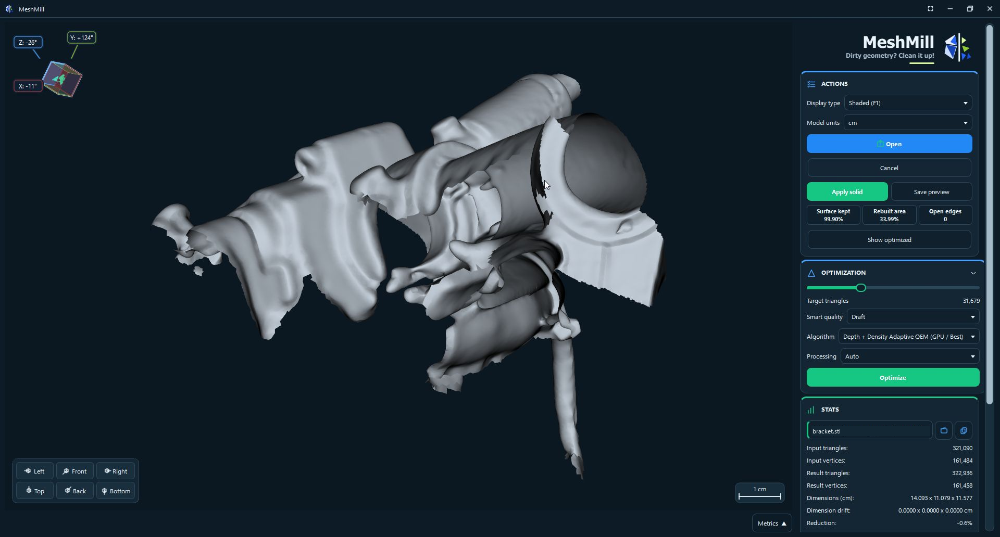

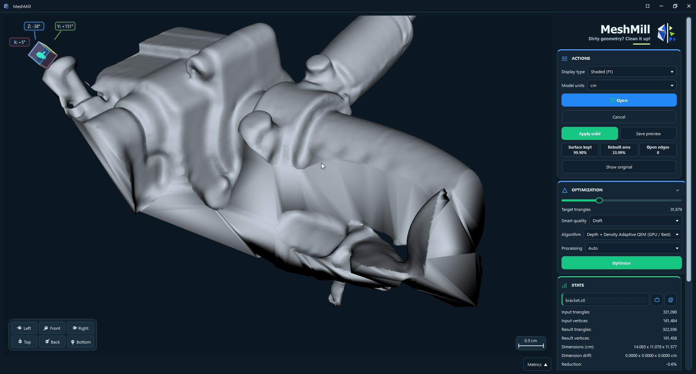

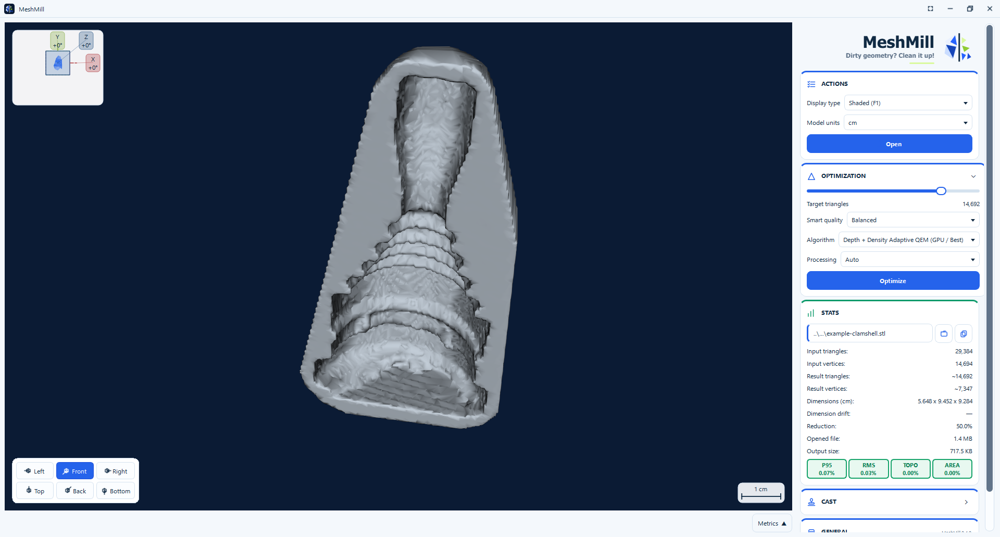

Clearance, wall thickness, gap bridging, and sampling start from the mesh geometry and can be adjusted.
Update the preview explicitly, inspect its fit, and replace the working mesh or export the result.
See the [Solidify and Cast guide](docs/SOLIDIFY_AND_CAST.md).

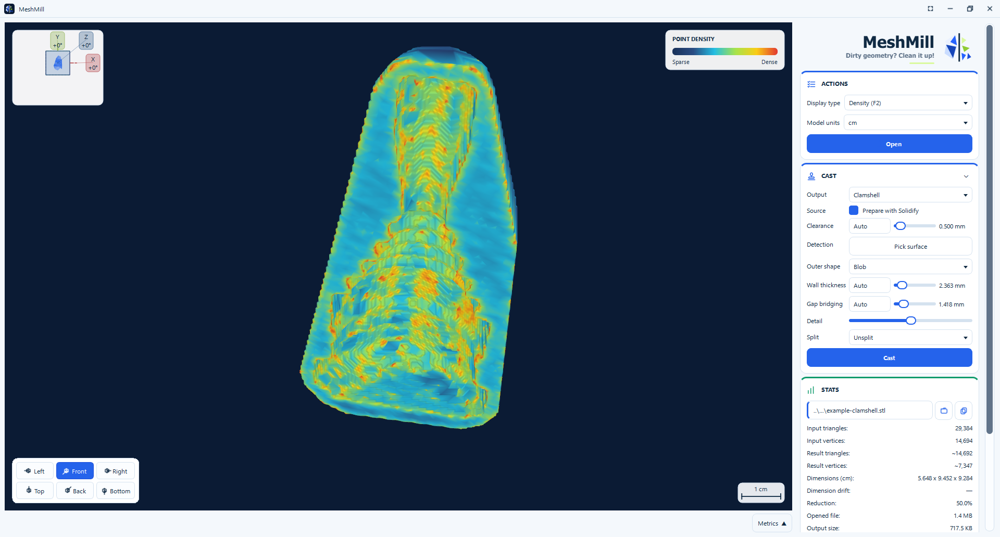

Compare formats by strengths, tradeoffs, downstream application support, face count, and estimated
size. Remember preferred options for compact saves, or select Compare formats to return to the
full comparison. Coplanar merging is off by default and runs once when saving if selected; opening
the dialog does not start geometry processing. See [opening and exporting geometry](docs/EXPORT_FORMATS.md).

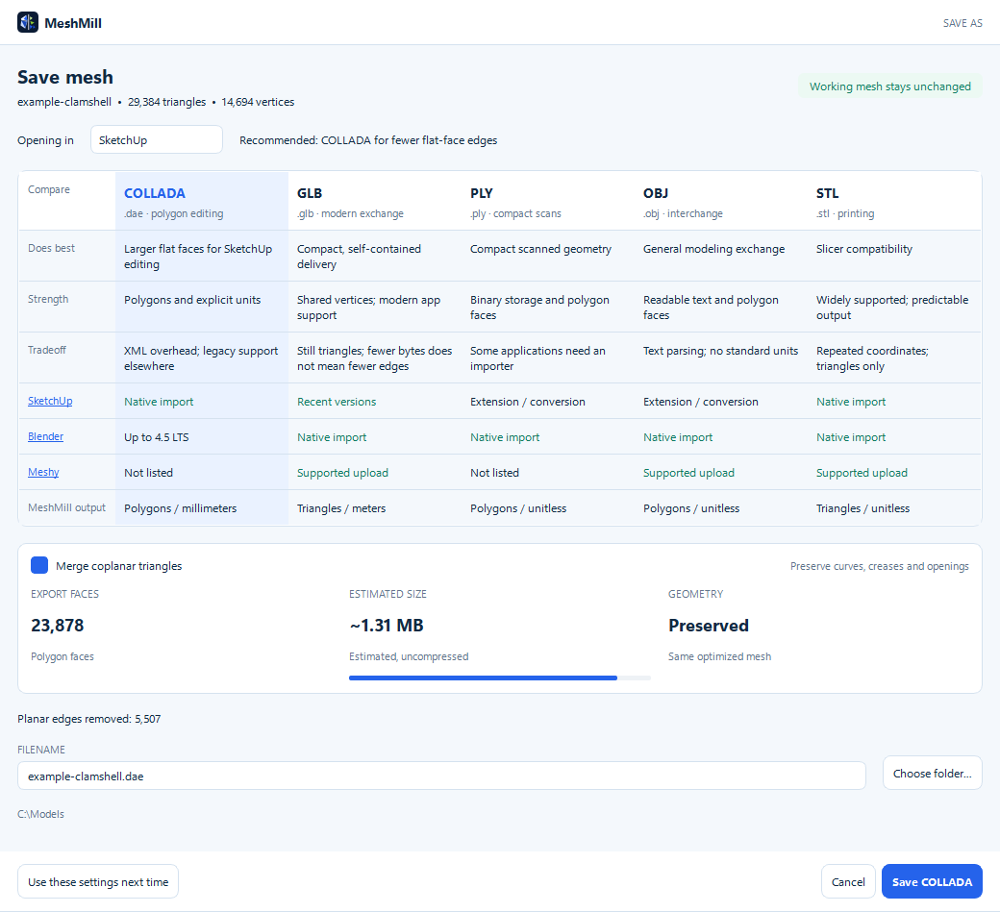

A generated cavity imported into SketchUp, followed by a Cura layer preview:

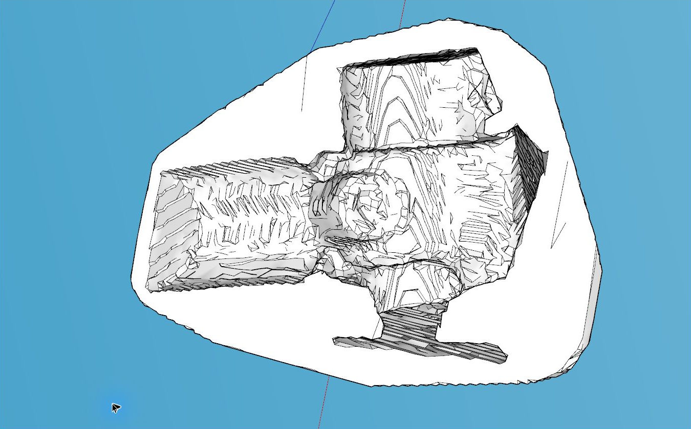

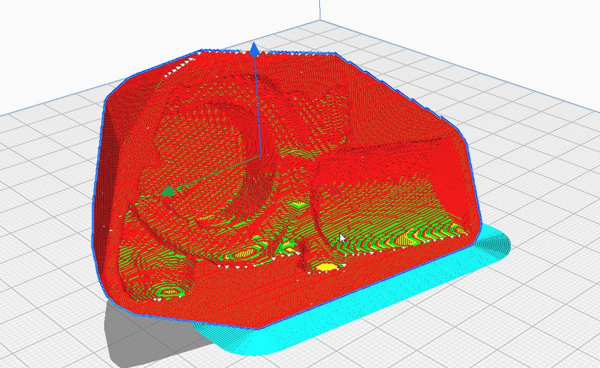

## Calibrate a rotation axis

Orient the model as you want to inspect it, then open **Axial calibration**. Choose an axis relative
to the current view, place contact probes at different surface heights, and select **Rotate**.
The probes measure the surface as it passes and adjust the rotation center and tilt.

A subtle horizontal/vertical viewport cross provides the alignment reference. Lighter original
axes show X/Y/Z degree offsets at both viewport edges. Adjust rotation, tilt, and alignment depth
with the keyboard; Ctrl+Shift+Up/Down moves the alignment axis in and out. Rotation keeps the
model fitted until you manually change zoom. Coverage and runout show the fit. Once detection reaches **Stable**, inspection continues without further
fitting. Select **Finalize** to keep the alignment, clear the overlays, and return to Optimize.
The mesh surface is unchanged. Finalized exports use the calibrated axis as Z and its center as
the origin, consistently across formats and generated workflows.


See the [axial calibration guide](docs/AXIAL_CALIBRATION.md) and
[published mathematical report](https://github.com/make-your-own-world/rnd/tree/main/axial-calibration).

## Inspect geometry before reducing it

The Shaded display provides a clean view of the surface and silhouette. It is useful for comparing
shape preservation before applying an optimization pass.

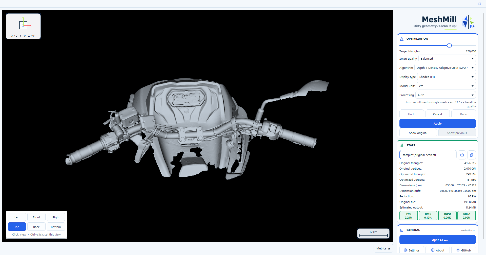

The Vertices display exposes the actual point distribution. Dense scan regions, sparse areas, and
abrupt changes in sampling are visible without changing the geometry. The metrics panel can track
CPU, memory, GPU, and geometry-processing activity while working with the mesh.

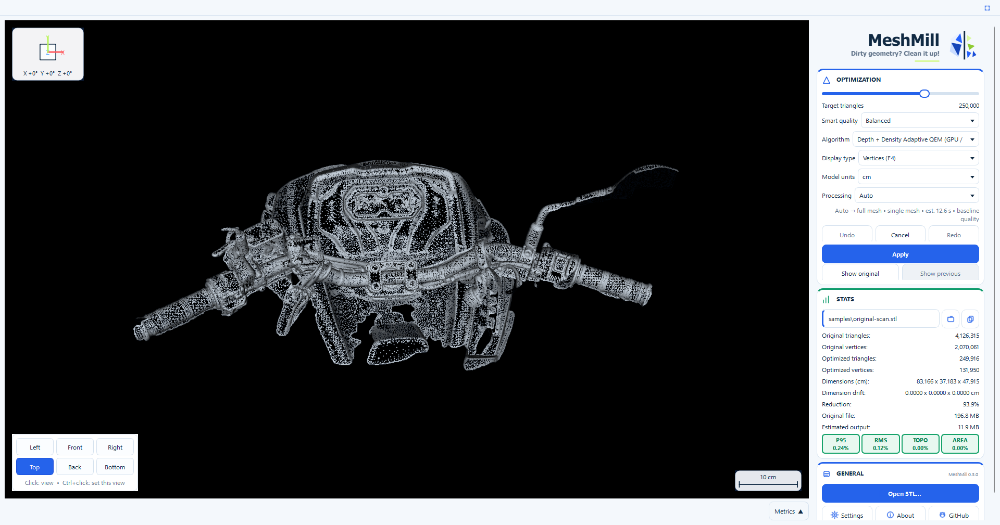

The Wireframe display shows triangle structure directly. It helps identify unnecessary density,
irregular triangulation, and regions where simplification can remove substantial geometry.

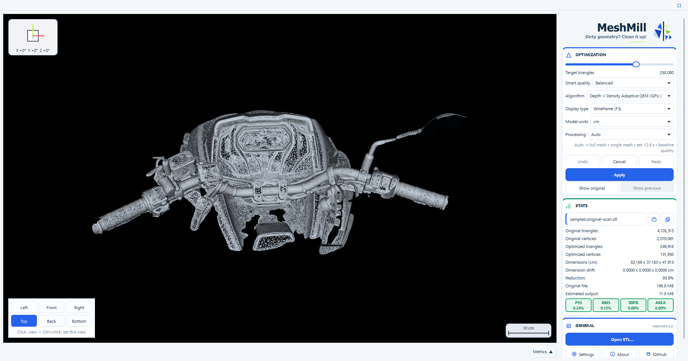

## Analyze mesh density

The Density display maps relative local density across the model. Sparse regions remain cool while
increasingly dense regions move through brighter colors, making uneven sampling visible at a glance.

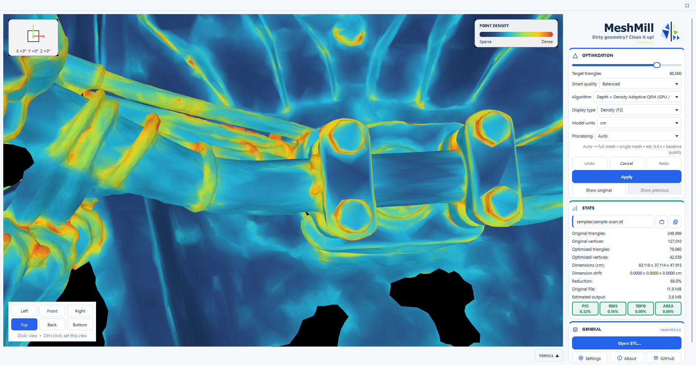

Density remains available while evaluating a provisional optimization. The toolbox reports the
algorithm, target, resulting triangle and vertex counts, reduction percentage, dimensions, and
estimated output size before the pass is applied.


Hold the right mouse button to inspect a region through the circular magnifier. The magnified view
stays centered on the pointer and reveals local density without changing the main camera position.

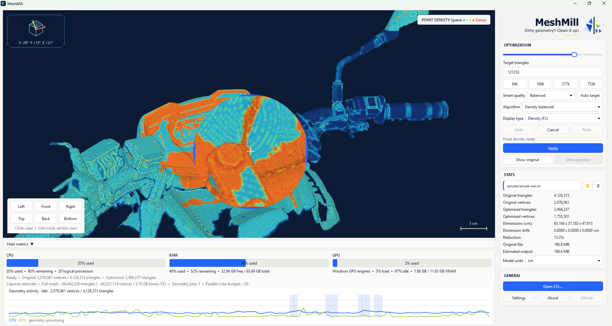

### Operation progress

A shared progress panel shows the current step, overall completion, elapsed time, and live resource
metrics while geometry processing runs.

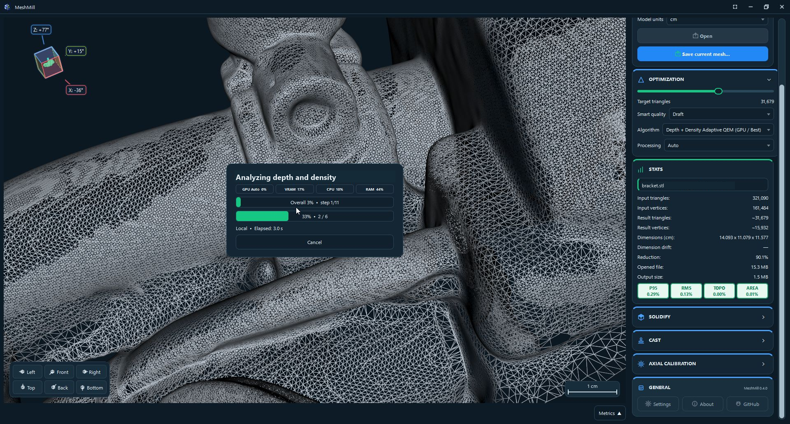

## View controls

| Input | Action |
| --- | --- |
| Left-drag | Pan |
| Middle-drag | Orbit around the visible mesh beneath the pointer |
| Shift + middle-drag | Pan |
| Mouse wheel | Zoom toward the pointer |
| Ctrl + mouse wheel | Roll clockwise or counterclockwise |
| Arrow keys | Rotate around the model center |
| Ctrl + arrow keys | Pan |
| Ctrl + Shift + Up/Down | Zoom; move alignment depth while Axial calibration is active |
| Ctrl + Shift + Left/Right | Roll |
| `F1` / `F2` / `F3` / `F4` | Shaded / Density / Wireframe / Vertices |
| Right mouse hold | Magnifier |
| Shift + left-click | Add or remove ruler points |
| Ctrl + left-drag | Draw a selection polygon |
| Ctrl + double-click | Add or remove the clicked connected component |
| `Ctrl+C` | Add the polygon to the saved selection |
| `Ctrl+X` | Crop to the selection |
| `Ctrl+Space` | Optimize the selection |
| `Delete` | Delete the selection |
| `Escape` | Clear the active selection or ruler |
| `Ctrl+Z` / `Ctrl+Y` | Undo / redo |
| `Ctrl+S` | Save the current mesh state |
| `F11` | Enter or leave fullscreen |
| `Space` (Axial calibration active) | Start or stop calibration rotation |

Standard view keys follow the six-key navigation block:

| Key | View | Ctrl + key |
| --- | --- | --- |
| `Insert` | Left | Set current orientation as Left |
| `Home` | Front | Set current orientation as Front |
| `Page Up` | Right | Set current orientation as Right |
| `Delete` | Top when no selection exists | Set current orientation as Top |
| `End` | Back | Set current orientation as Back |
| `Page Down` | Bottom | Set current orientation as Bottom |

Saving a view also updates its opposite view. Left and Right, Front and Back, and Top and Bottom
remain paired. In the confirmation dialog, **Save** is the default action, so Enter saves the
orientation. Front appears at the top of both Top and Bottom views.

Shortcuts can be changed or reset in Settings. A single rotation-key press moves one degree;
holding the key accelerates smoothly. Panning and zooming also start gently and respond continuously.
Repeated rotation retains its pivot. During Axial calibration, automatic framing keeps the model fitted
until manual zoom takes precedence.
Preferences search filters setting names and section headings.

## Selection workflow

Hold Ctrl and left-drag to draw a polygon. Drag corners to reshape it, left-click an edge to add a
point, or right-click an edge to remove one. Ctrl-drag another region to retain the previous
selection and add to it. Enter or `Ctrl+C` can also retain a region explicitly.
Shrinking the current outline removes geometry outside it without
removing separately added regions. Empty outlines remain editable.

Ctrl+double-click a mesh to add its connected component to the selection, or remove that component
if it is already fully selected. Other selected components are preserved.
Triangles connected through shared vertices are included; disconnected geometry across a gap
is excluded. This selects by mesh connectivity, rather than by proximity or visible outline.

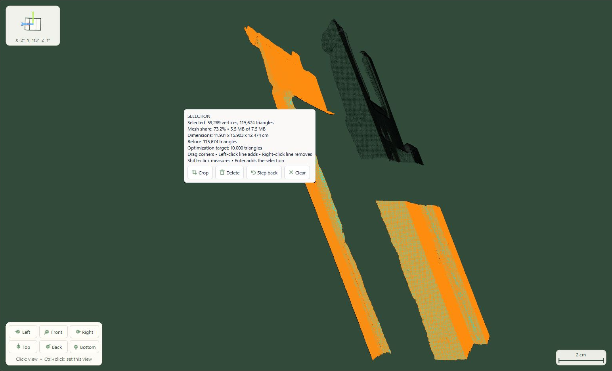

Modifier keys do not dismiss the outline. Shift-click adds or removes ruler points while a selection
is active. Camera rotation clears the ruler. Camera movement preserves the selected geometry but
clears the view-specific outline.
Draw a new outline to add a selection from the new view. Clicking inside
the outline does not add or apply it.

Optimization with an active selection affects that selection only. The result remains provisional
until **Apply** is selected. **Cancel** discards the provisional result and clears the selection.
Crop and delete operations become normal undoable mesh edits.

The selection panel reports the cumulative selected vertices, triangles, mesh share, estimated
size, and dimensions. Its actions crop, delete, step back, or clear the retained
selection without hiding the surrounding geometry. Use **Optimize selection** in the toolbox
to reduce the highlighted geometry.

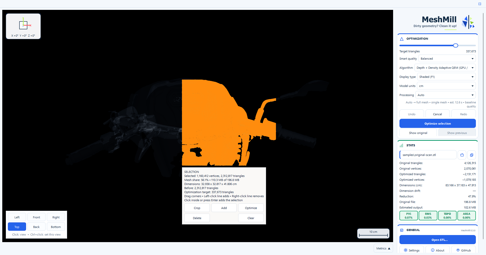

## Large meshes

Before allocating a binary STL, MeshMill compares its estimated working memory with the configured
memory budget. Oversized files can open as a bounded overview or use **Tiled processing**. Tiled
processing builds a reusable disk-backed spatial index, optimizes independent regions within the
configured memory and process limits, validates their protected boundaries, and streams the final
STL without loading one global geometry array. Completed tiles are checkpointed for interruption
recovery. The design, formulas, benchmark, and current limitations are documented in
[docs/TILED_PROCESSING.md](docs/TILED_PROCESSING.md).

## Updates

Update checks are off by default. Click the version beside **General** to check manually, or enable
one check when MeshMill opens in Settings. Supported installer builds can download a newer release,
verify its GitHub SHA-256 digest, replace the installed version, and reopen the active STL. Portable
archives are not modified in place. Platform packaging status and the updater contract are documented
in [docs/UPDATES.md](docs/UPDATES.md).

## Command line

`MeshMillCLI.exe` is included in both release packages:

```powershell
.\MeshMillCLI.exe "C:\path\mesh.stl" --quality balanced
.\MeshMillCLI.exe "C:\path\mesh.stl" --quality fine
.\MeshMillCLI.exe "C:\path\mesh.stl" --target 150000 --output "C:\path\mesh-reduced.stl"
.\MeshMillCLI.exe "C:\path\mesh.stl" --algorithm depth-adaptive --target 150000
.\MeshMillCLI.exe "C:\path\mesh.stl" --algorithm depth-density-adaptive --target 150000 --gpu 00000000:01:00.0
.\MeshMillCLI.exe "C:\path\mesh.stl" --algorithm density --target 150000
.\MeshMillCLI.exe "C:\path\mesh.stl" --algorithm shape --target 150000
.\MeshMillCLI.exe "C:\path\mesh.stl" --algorithm topology --target 150000 --output "C:\path\mesh-reduced.stl" --overwrite
```

By default, the CLI uses the same Balanced Smart quality calculation as a new MeshMill window and
selects the highest-quality compatible algorithm. `--quality` derives a target from the loaded mesh;
`--target` sets an exact count. `--preset` remains available for scripts that require the earlier
fixed 50k, 200k, or 400k targets. Available algorithms are `auto`, `fast`, `density`, `shape`,
`topology`, `depth-adaptive`, and `depth-density-adaptive`. The two depth-guided algorithms require
a compatible NVIDIA CUDA runtime. They accept `--gpu` with a CUDA PCI bus ID, or use the
system-selected CUDA GPU by default. `--aggressiveness` accepts values from `0` (quality) through
`10` (speed), with `7` as the default. Run `.\MeshMillCLI.exe --help` for all options. MeshMill
refuses to overwrite its input file.

**Generate PowerShell script** replays committed Optimize, Solidify and Cast operations without
opening the GUI. Reduction passes retain their algorithm, Draft/Balanced/Fine quality, GPU and
processing settings. Each pass derives its target from its current input. Crops, selection edits
and manually guided surfaces become an input-mesh checkpoint, followed by subsequent tool steps.
The script is editable and accepts `-InputMesh`, `-OutputMesh` and `-CliPath` overrides.

Inputs and outputs support STL, COLLADA, GLB, OBJ and PLY. For an explicit multi-tool pipeline,
use `--workflow workflow.json --output result.stl`. See [automation workflows](docs/AUTOMATION.md)
for the file format, operation settings and examples.

## Algorithm reference

Algorithm contributors should also read the
[algorithm testing guide](docs/ALGORITHM_TESTING.md) before comparing or changing reduction
behavior.

The [algorithm reference](docs/ALGORITHMS.md) documents the production formulas, implementation
sources, MeshMill-specific decisions, and density-display analysis. The
[GPU QEM and depth-analysis note](docs/GPU_QEM_AND_DEPTH_ANALYSIS.md) explains why ray, depth, and
surface-measurement workloads benefit from GPU parallelism while ordered QEM topology mutation did
not, including the measured prototype results. The
[full algorithm comparison](benchmarks/ALGORITHM_COMPARISON.md) records CPU, GPU, quality, topology,
and runtime results for released algorithms and completed prototypes.

The [Depth Adaptive QEM design](docs/DEPTH_GAUGE_REDUCTION.md) records the project-originated
physical-probe model, its complete mathematics, the GPU execution profile, and why the other GPU
approaches tested during development were rejected. The published paper,
[Depth Adaptive QEM: GPU-Guided Surface Measurement for Practical Mesh Reduction](https://github.com/make-your-own-world/rnd/blob/main/depth-adaptive-qem/depth-adaptive-qem-v1.1.pdf),
provides the consolidated derivation, measurements, comparisons, and research context. The
[production reducer comparison](benchmarks/CURRENT_BEST_COMPARISON.md) provides matched resident
timings, numerical quality metrics, and six identical camera views for all production reducers.

## STL units

STL does not encode a unit. Changing Model units changes labels and measurements without scaling
the saved coordinates. Select the unit that describes the source geometry.

## Privacy

MeshMill reads and writes local files. It contains no account, telemetry, upload, advertising, or
cloud-processing feature. The current GPU metrics implementation uses local Windows performance
counters. Equivalent native metrics providers are planned for Linux and macOS.

For diagnostic troubleshooting, developers can start the GUI with
`--diagnostic-log <local-file.jsonl>`. The log records input routing and camera state locally and is
disabled during normal use.

## Development and release

Localized UI text and documentation are initially produced with external machine-translation
services and checked automatically for structural damage. Machine translation can still be
unnatural or incorrect. Native speakers are encouraged to review and correct translations through
the contribution process.

- [Contributing](CONTRIBUTING.md)
- [Release process](RELEASING.md)
- [Roadmap](ROADMAP.md)
- [Troubleshooting](docs/TROUBLESHOOTING.md)
- [Third-party notices](THIRD_PARTY_NOTICES.md)

## Support MeshMill

MeshMill is independently developed and maintained. Read
[why supporting this work matters](SUPPORT.md), or support continued development through
[Buy Me a Coffee](https://buymeacoffee.com/tednv).

MeshMill is licensed under the GNU General Public License, version 3 or later. See
[`LICENSE`](LICENSE).
